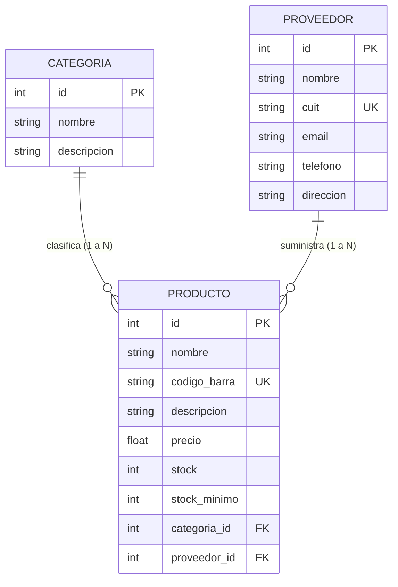

# Ferretería Industrial API 🛠️
### Evaluación Final Integradora (EFI) — Práctica Profesionalizante 1 (PP1 - Python)
**Instituto Tecnológico (ITEC)**

---

## 👥 Integrantes del Equipo
* **Integrante 1:** [Nombre y Apellido] — [Email / GitHub]
* **Integrante 2:** [Nombre y Apellido] — [Email / GitHub]
* **Integrante 3:** [Nombre y Apellido] — [Email / GitHub]
* **Integrante 4:** [Nombre y Apellido] — [Email / GitHub]

---

## 📖 Descripción del Proyecto
Este proyecto corresponde a la **Evaluación Final Integradora (EFI)** de la materia **Práctica Profesionalizante 1 (Python)**, articulada en conjunto con la materia **PP1 - JavaScript**.

Consiste en una API RESTful completa y robusta desarrollada con **FastAPI** para la gestión integral de una **Ferretería Industrial**. El sistema permite administrar las categorías de artículos, los proveedores mayoristas o fabricantes y el catálogo de productos con control de stock, precios y códigos de barra.

---

## 🚀 Tecnologías y Herramientas Utilizadas
* **Lenguaje:** Python 3.10+ (probado en Python 3.13)
* **Framework Web:** [FastAPI](https://fastapi.tiangolo.com/) (con `fastapi[standard]`)
* **ORM & Modelado:** [SQLModel](https://sqlmodel.tiangolo.com/) (integración de SQLAlchemy y Pydantic)
* **Base de Datos:** SQLite local (`ferreteria.db`)
* **Migraciones de Base de Datos:** [Alembic](https://alembic.sqlalchemy.org/)
* **Paginación:** [fastapi-pagination](https://uriyyo-fastapi-pagination.netlify.app/)
* **Tipado estricto:** Tipos declarados con `Annotated` y validación de schemas de entrada/salida
* **CORS:** Habilitado para permitir la conexión directa con el frontend de **PP1 - JavaScript**

---

## 📁 Estructura del Proyecto
El proyecto respeta de manera estricta la arquitectura modular requerida:

```text
.
├── .gitignore
├── README.md
├── requirements.txt
├── test_api.py
├── alembic.ini
├── alembic/
│   ├── env.py
│   ├── README
│   ├── script.py.mako
│   └── versions/
│       └── 207df0a572b0_migracion_inicial_de_ferreteria.py
└── src/
    ├── main.py
    ├── database.py
    ├── seed.py
    ├── models/
    │   ├── __init__.py
    │   ├── categoria.py
    │   ├── proveedor.py
    │   └── producto.py
    └── routers/
        ├── __init__.py
        ├── categoria.py
        ├── proveedor.py
        └── producto.py
```

---

## 🗄️ Modelo de Datos y Relaciones

El sistema implementa 3 modelos principales persistidos en SQLite, cumpliendo con las relaciones de clave foránea requeridas:



### Cumplimiento de Requisitos de Modelos:
1. **Campos definidos con `Annotated`:** Todos los atributos de los modelos utilizan `Annotated[Tipo, Field(...)]`.
2. **Jerarquía de Clases por Archivo:**
   * **Base:** Atributos compartidos (`CategoriaBase`, `ProveedorBase`, `ProductoBase`).
   * **Tabla (`table=True`):** Modelo que mapea con la tabla en SQLite (`Categoria`, `Proveedor`, `Producto`).
   * **Create:** Esquema de validación para `POST` (`CategoriaCreate`, `ProveedorCreate`, `ProductoCreate`).
   * **Update:** Esquema opcional para `PATCH` (`CategoriaUpdate`, `ProveedorUpdate`, `ProductoUpdate`).
   * **Public:** Esquema de salida para respuestas planas (`CategoriaPublic`, `ProveedorPublic`, `ProductoPublic`).
   * **Nested:** Esquema anidado para respuestas relacionales (`CategoriaPublicNested`, `ProveedorPublicNested`, `ProductoPublicNested`).

---

## 🛠️ Instalación y Puesta en Marcha

### 1. Clonar el repositorio
```bash
git clone <URL_DEL_REPOSITORIO>
cd efi
```

### 2. Crear y activar el entorno virtual
En Windows (PowerShell):
```powershell
python -m venv .venv
.\.venv\Scripts\Activate.ps1
```
*(O utilizando `uv`: `uv venv` y `.venv\Scripts\activate`)*

### 3. Instalar las dependencias
```bash
pip install -r requirements.txt
```

### 4. Ejecutar las migraciones de Alembic
Aplica la migración inicial para crear las tablas con sus índices y claves foráneas:
```bash
alembic upgrade head
```

### 5. (Opcional) Poblar la base de datos con datos de prueba
Ejecuta el script de semilla con categorías, proveedores y productos reales de ferretería:
```bash
python src/seed.py
```

### 6. Iniciar el servidor de desarrollo
Con `fastapi` CLI:
```bash
fastapi dev src/main.py
```
O con `uvicorn`:
```bash
uvicorn src.main:app --reload
```

El servidor quedará disponible en: **`http://127.0.0.1:8000`**

---

## 🧪 Pruebas Automatizadas
Para verificar el correcto funcionamiento de todos los endpoints, paginación, códigos de estado 404 documentados y esquemas anidados:
```bash
python test_api.py
```

---

## 📡 Endpoints de la API (Path Operations)

La API cuenta con las **5 operaciones CRUD por cada modelo** (15 endpoints en total), agrupadas en routers modulares:

### 🗂️ Categorías (`/categorias`)
| Método | Endpoint | Descripción | Esquema Entrada | Esquema Salida | Código Éxito | Error 404 |
| :--- | :--- | :--- | :--- | :--- | :--- | :--- |
| **POST** | `/categorias/` | Crear una nueva categoría | `CategoriaCreate` | `CategoriaPublic` | `201 Created` | — |
| **GET** | `/categorias/` | Listar categorías paginadas | Query `?page=1&size=10` | `Page[CategoriaPublic]` | `200 OK` | — |
| **GET** | `/categorias/{id}` | Obtener categoría por ID con productos | — | `CategoriaPublicNested` | `200 OK` | Sí (Documentado) |
| **PATCH** | `/categorias/{id}` | Actualización parcial | `CategoriaUpdate` | `CategoriaPublic` | `200 OK` | Sí (Documentado) |
| **DELETE** | `/categorias/{id}` | Eliminar categoría | — | Mensaje JSON | `200 OK` | Sí (Documentado) |

### 🏢 Proveedores (`/proveedores`)
| Método | Endpoint | Descripción | Esquema Entrada | Esquema Salida | Código Éxito | Error 404 |
| :--- | :--- | :--- | :--- | :--- | :--- | :--- |
| **POST** | `/proveedores/` | Registrar proveedor | `ProveedorCreate` | `ProveedorPublic` | `201 Created` | — |
| **GET** | `/proveedores/` | Listar proveedores paginados | Query `?page=1&size=10` | `Page[ProveedorPublic]` | `200 OK` | — |
| **GET** | `/proveedores/{id}`| Obtener proveedor por ID con productos | — | `ProveedorPublicNested` | `200 OK` | Sí (Documentado) |
| **PATCH** | `/proveedores/{id}`| Actualización parcial | `ProveedorUpdate` | `ProveedorPublic` | `200 OK` | Sí (Documentado) |
| **DELETE** | `/proveedores/{id}`| Eliminar proveedor | — | Mensaje JSON | `200 OK` | Sí (Documentado) |

### 🔧 Productos (`/productos`)
| Método | Endpoint | Descripción | Esquema Entrada | Esquema Salida | Código Éxito | Error 404 |
| :--- | :--- | :--- | :--- | :--- | :--- | :--- |
| **POST** | `/productos/` | Registrar producto (valida FKs y código único) | `ProductoCreate` | `ProductoPublic` | `201 Created` | — |
| **GET** | `/productos/` | Listar catálogo paginado | Query `?page=1&size=10` | `Page[ProductoPublic]` | `200 OK` | — |
| **GET** | `/productos/{id}` | Obtener producto por ID (con categoría y proveedor anidados) | — | `ProductoPublicNested` | `200 OK` | Sí (Documentado) |
| **PATCH** | `/productos/{id}` | Actualización parcial | `ProductoUpdate` | `ProductoPublic` | `200 OK` | Sí (Documentado) |
| **DELETE** | `/productos/{id}` | Eliminar producto | — | Mensaje JSON | `200 OK` | Sí (Documentado) |

---

## 📑 Documentación Interactiva
FastAPI genera automáticamente documentación interactiva accesible en el navegador:
* **Swagger UI:** [http://127.0.0.1:8000/docs](http://127.0.0.1:8000/docs)
* **ReDoc:** [http://127.0.0.1:8000/redoc](http://127.0.0.1:8000/redoc)

En `/docs` se encuentran debidamente detallados los esquemas, parámetros de consulta para la paginación (`page`, `size`) y las respuestas de error `404 Not Found` en los endpoints correspondientes.

---

## 🌐 Conexión con PP1 - JavaScript (Frontend)
El servidor cuenta con `CORSMiddleware` habilitado para todos los orígenes (`allow_origins=["*"]`), permitiendo que el proyecto de frontend en JavaScript consuma los endpoints de manera directa usando `fetch`:

```javascript
// Ejemplo: Obtener productos paginados desde JavaScript
async function obtenerProductos(pagina = 1, tamano = 10) {
  try {
    const respuesta = await fetch(`http://127.0.0.1:8000/productos/?page=${pagina}&size=${tamano}`);
    if (!respuesta.ok) throw new Error("Error al consultar el catálogo");
    
    const data = await respuesta.json();
    console.log("Total de productos:", data.total);
    console.log("Página actual:", data.page);
    console.log("Listado de artículos:", data.items);
    return data;
  } catch (error) {
    console.error(error);
  }
}
```

---

## 🌿 Flujo de Trabajo Git (GitFlow)
El repositorio sigue el estándar de desarrollo colaborativo de **GitFlow**:
* `main`: Código en producción, estable y versionado listo para la entrega final.
* `develop`: Rama principal de integración para el desarrollo activo.
* `feature/...`: Ramas de características individuales (`feature/models`, `feature/migrations`, `feature/routers`, `feature/docs`).
